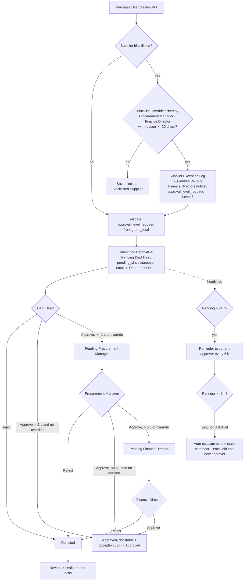
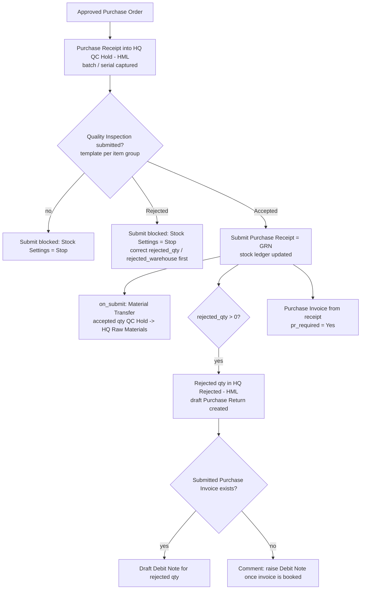
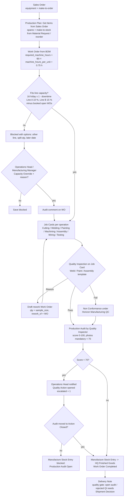
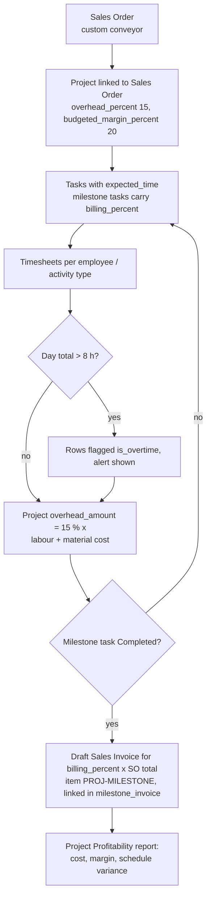

# Horizon Manufacturing Ltd - Configuration Design Document

| | |
| --- | --- |
| Client | Horizon Manufacturing Ltd (abbr `HML`) |
| Platform | Frappe 15.96 / ERPNext 15.94 / HRMS 15.55 / India Compliance 15.25 |
| Site | `horizon.local` |
| Custom app | `horizon_erp` (modules Horizon Operations, Horizon Quality, Horizon Finance, Horizon Integration) |
| Fiscal year | 2026-27 (1 Apr 2026 - 31 Mar 2027) |
| Configuration as code | `horizon_erp/setup/demo_data.py` (`setup_all`), `setup/demo_hr_finance.py`, `setup/workflows.py`, `setup/notifications.py`, `setup/print_formats.py`, `setup/custom_fields.py` |
| Status | Build complete for the items marked Standard / Configuration / Custom code below; items marked **Designed only** are documented but not built |

Everything in this document is derived from the setup scripts and hook code in the app. Where a
behaviour is described but could not be confirmed in code it is marked **(verify before submission)**.

---

## 1. Company, branch and warehouse structure

### 1.1 Decision: one company, two GST registrations, Branch as an accounting dimension

| Option | P&L by location | Inventory visibility | Inter-location transfer | Payroll / masters | Verdict |
| --- | --- | --- | --- | --- | --- |
| Two companies (HQ Ltd, DC Ltd) | Native | Split across companies; consolidation needed | Inter-company Sales Invoice / Purchase Invoice pairs, internal customer + supplier, two sets of books | Duplicated | Rejected: Horizon is one legal entity; creating a second company invents a legal person that does not exist |
| **One company + Branch dimension (chosen)** | Branch filter on P&L; `mandatory_for_pl = 1` forces every P&L posting to carry a branch | One stock ledger, one Bin table, group warehouses per site | Stock Entry (Material Transfer) through an in-transit warehouse; IGST handled because the two sites hold different GSTINs | One set of masters | Chosen |

Configured in `demo_data.setup_branches_and_dimension`: Branches `Mumbai HQ` and `Delhi DC`;
Accounting Dimension on `Branch` with company default `Mumbai HQ` and **Mandatory for Profit and Loss
Account**. Company default cost centre is `Admin - HML`.

GST registrations (`demo_data.COMPANY_ADDRESSES`, company addresses with `is_your_company_address = 1`):

| Site | State | GSTIN used | Note |
| --- | --- | --- | --- |
| Horizon HQ Mumbai | Maharashtra (27) | `27AABCU9602H1Z9` | The brief's `27AABCU9602H1Z0` fails the GSTIN check-digit; India Compliance rejects it. Same PAN, checksum-valid variant used. Raised as a client data issue. |
| Horizon DC Delhi | Delhi (07) | `07AABCU9602H1ZB` | Generated from the same PAN with `make_gstin()` and verified with `india_compliance.gst_india.utils.validate_gstin`. |

### 1.2 Warehouse hierarchy (`demo_data.WAREHOUSES`)

```
All Warehouses - HML
├── Mumbai HQ - HML (group)
│   ├── HQ Raw Materials - HML        default for raw / components; reorder warehouse
│   ├── HQ QC Hold - HML              every Purchase Receipt lands here
│   ├── HQ Work In Progress - HML     WIP for Work Orders; default for sub-assemblies
│   ├── HQ Finished Goods - HML       equipment and spares
│   ├── HQ Rejected - HML             is_rejected_warehouse = 1 (QC rejections)
│   └── HQ Scrap - HML                target of "Mark for Scrap"
└── Delhi DC - HML (group)
    ├── DEL Finished Goods - HML      regional sales stock
    └── DEL Goods In Transit - HML    warehouse_type Transit; Company.default_in_transit_warehouse
```

Justification: the brief asks for 2 + 1 warehouses; the extra HQ warehouses are what make the
quality gates enforceable (QC Hold, Rejected, Scrap) and the transit warehouse is what makes an
inter-branch movement auditable (goods are neither at HQ nor at DC while on the truck).

Transfer process (HQ to DC): Stock Entry *Material Transfer* with `add_to_transit`, source
`HQ Finished Goods - HML`, in-transit `DEL Goods In Transit - HML`; receiving Stock Entry at Delhi
closes the transit. Valuation moves at **Moving Average cost**; no mark-up (same legal entity). GST
treatment for the inter-GSTIN movement is covered in ADR-10 (`02_decision_log.md`) and is
**Designed only**: the demo does not post the inter-branch tax document.

### 1.3 Stock settings that enforce the design (`demo_data.setup_company_settings`)

| Setting | Value | Effect |
| --- | --- | --- |
| Stock Settings `allow_negative_stock` | 0 | Negative stock from migration cannot recur |
| `action_if_quality_inspection_is_not_submitted` / `_is_rejected` | Stop / Stop | A Purchase Receipt cannot be submitted without an accepted Quality Inspection |
| `auto_indent`, `reorder_email_notify` | 1 / 1 | Hourly reorder creates Material Requests and emails |
| `valuation_method` | Moving Average (also set per item) | ERPNext refuses a global change once ledgers exist; every demo item carries it explicitly |
| `use_serial_batch_fields` | 1 | Batch / serial captured directly on receipt and delivery rows |
| Buying Settings `po_required`, `pr_required` | Yes / Yes | No invoice without PO and receipt (migration problem 3 cannot recur) |
| Selling Settings `so_required`, `dn_required` | Yes / Yes | No invoice without order and delivery (plus the hook in 6.5) |
| CRM Settings `default_valid_till` | 30 | Quotation validity 30 days |
| Accounts Settings `enable_common_party_accounting` | 1 | ABC Corp offset (ADR-6) |
| Accounts Settings `credit_controller` | Finance Director | Only the FD can release a credit-limit block |
| Accounts Settings `book_asset_depreciation_entry_automatically` | 1 | Monthly depreciation Journal Entries without manual action |

---

## 2. Chart of Accounts and cost-centre design

### 2.1 Accounts added (`demo_data.setup_accounts`, `demo_hr_finance._payroll_accounts`)

| Account | Parent | Purpose |
| --- | --- | --- |
| Sales - Equipment / Sales - Spares / Sales - Components | Direct Income | Revenue by product line (second axis next to cost centre) |
| Factory Overhead | Indirect Expenses | Shared plant cost before allocation |
| Rework Cost, Scrap Loss | Direct Expenses | Cost of poor quality made visible in the P&L |
| Stock Adjustment - Migration (type Stock Adjustment) | Stock Expenses | Absorbs negative-stock clean-up at go-live, separately from operational adjustments |
| PF Payable, ESI Payable, Professional Tax Payable, TDS Payable | Duties and Taxes | Statutory payroll liabilities |
| Insurance Premium Payable, Employee Loan Recovery | Current Liabilities | Payroll deductions |
| Production Equipment, Vehicles, IT Equipment (Fixed Asset) + Accumulated Depreciation - <class> | Fixed Assets | One asset class per Asset Category |
| Rent Payable, Electricity Payable | Current Liabilities | Recurring accrual journals |

### 2.2 Cost-centre tree (`demo_data.COST_CENTERS`)

```
Horizon Manufacturing Ltd - HML
├── Manufacturing - HML (group)
│   ├── Mfg - Equipment - HML
│   ├── Mfg - Spares - HML
│   ├── Mfg - Components - HML
│   └── Mfg - Shared - HML          leaf; Cost Center Allocation 50 / 30 / 20 to the three above
├── Sales - HML
├── Admin - HML                     company default
└── R&D - HML
```

Item Defaults (`demo_data.KIND_DEFAULTS`) pin the buying and selling cost centre per item kind:
raw / components -> `Mfg - Components`, sub-assemblies and equipment -> `Mfg - Equipment`,
spares -> `Mfg - Spares`, fixed assets -> `Admin`. Departments carry `payroll_cost_center`
(Manufacturing and Quality -> Mfg - Equipment, Sales -> Sales, Admin and Stores -> Admin, R&D -> R&D)
and every Employee carries `payroll_cost_center` and `branch`.

Dimensions available on every GL posting: **Account x Cost Center x Branch x Project**.

### 2.3 Worked example 1 - factory electricity INR 1,00,000 allocated 50 / 30 / 20

Post the bill once to the shared leaf; the submitted Cost Center Allocation
(`main_cost_center = Mfg - Shared - HML`, valid from 1 Apr 2026) splits it at posting time.

| Journal Entry line (user enters) | Debit | Credit | Cost Center | Branch |
| --- | --- | --- | --- | --- |
| Electricity Expenses | 1,00,000 | | Mfg - Shared - HML | Mumbai HQ |
| Electricity Payable | | 1,00,000 | Admin - HML | Mumbai HQ |

| GL Entry (system writes) | Debit | Cost Center |
| --- | --- | --- |
| Electricity Expenses | 50,000 | Mfg - Equipment - HML |
| Electricity Expenses | 30,000 | Mfg - Spares - HML |
| Electricity Expenses | 20,000 | Mfg - Components - HML |

The demo's recurring "Factory Electricity" journal (`demo_hr_finance.step_recurring_journal_entries`)
shows the alternative: a pre-split journal (40,000 / 24,000 / 16,000) with a monthly Auto Repeat.
Both land in the same three leaves; the allocation route is preferred because the split is a
master-data decision that finance can change once, not something each accountant retypes.

### 2.4 Worked example 2 - Delhi sales salary

Employee Anjali Desai (Sales Executive, Department Sales, `payroll_cost_center = Sales - HML`,
`branch = Delhi DC`). Payroll Entry is run **per branch** (`demo_hr_finance._payroll_branches`)
because HRMS copies the Branch dimension from the Payroll Entry onto the accrual journal.

| Accrual journal line | Debit | Credit | Cost Center | Branch |
| --- | --- | --- | --- | --- |
| Salary | 45,000 gross | | Sales - HML | Delhi DC |
| PF Payable / ESI Payable / Professional Tax Payable | | statutory | Sales - HML | Delhi DC |
| Payroll Payable | | net | Sales - HML | Delhi DC |

Result: *Cost Center Wise P and L* (filter Sales) shows the cost of the sales function; the standard
Profit and Loss Statement with filter `Branch = Delhi DC` shows the cost of running Delhi; both
reconcile to the same GL because they are two filters on one ledger.

Reports built for this axis: **Cost Center Wise P and L** (YTD pivot or month pivot, with an
*unallocated* column for entries without a cost centre) and the standard Budget Variance Report.

---

## 3. Permission model

Roles created by `setup/roles.py` (fixture): Department Head, Procurement Manager, Finance Director,
Operations Head, Sales Manager, Warehouse Manager, Quality Inspector, HR Manager. Demo users
(`demo_data.USERS`, password `Horizon@123`, demo only):

| User | Horizon role(s) | ERPNext roles | Sees / may do |
| --- | --- | --- | --- |
| dept.head@horizon.local | Department Head | Purchase User, Stock User, Employee | Raise POs, approve Level 1 (< INR 1 L), receive budget alerts and the monthly budget report |
| procure@horizon.local | Procurement Manager | Purchase Manager, Purchase User, Stock User | Approve Level 2 (INR 1-5 L), tick Blacklist Override, own Supplier Exception Log and Quarterly Purchase Plan |
| rajesh@horizon.local | Finance Director | Accounts Manager, Accounts User, Purchase Manager | Approve Level 3 (> INR 5 L and every blacklist override), approve payments >= INR 1 L, invoice without Delivery Note (logged), credit-limit controller, all stock and all branches, API Usage Report, Bank Reconciliation Sign-off |
| priya@horizon.local | Operations Head | Manufacturing Manager/User, Stock Manager/User | Capacity override, review and close Production Audits, Shipment Decision, Mark for Scrap, receives low-audit and conflict alerts, daily summary |
| amit@horizon.local | Sales Manager | Sales User | Approve discounts > 15 %, ad-hoc price list edits, Shipment Decision (sales approver) |
| wh.delhi@horizon.local | Warehouse Manager | Stock User, Stock Manager | **User Permission: Warehouse = `Delhi DC - HML` (default, applies to descendants)** - list views, forms and stock transactions limited to DEL warehouses |
| qc@horizon.local | Quality Inspector | Quality Manager, Manufacturing User, Stock User | Quality Inspection, Production Audit (create/submit), Shipment Decision (quality approver) |
| neha@horizon.local | HR Manager | HR User, Payroll User (if present) | Attendance, leave, payroll |

Custom DocType permissions (from the DocType JSON): Production Audit - Quality Inspector create/submit,
Operations Head submit/cancel; Shipment Decision - Sales Manager, Quality Inspector, Operations Head
full, Finance Director read/submit; Supplier Exception Log - Procurement Manager write, Finance
Director read; Budget Override Request - Department Head submit, Finance Director cancel; Bank
Reconciliation Sign-off - Finance Director, Accounts Manager; Inventory API Log / API Usage Report -
System Manager, Finance Director.

Known limitation **(verify before submission)**: the Inventory API checks `read` on `Bin` but does
not apply the Warehouse user permission to the requested warehouse, so `wh.delhi` could query an
HQ warehouse through the API. Recommended fix: `frappe.has_permission("Warehouse", doc=resolved)`
in `api/inventory.py` before the data query.

---

## 4. Workflow diagrams

### 4.1 Purchasing - PO approval (`setup/workflows.py` "Horizon PO Approval") and QC-Hold receipt





### 4.2 Manufacturing - order to finished goods with quality gates



### 4.3 Projects - order to milestone invoice



---

## 5. Requirement matrix - Standard / Configuration / Custom code / Designed only

Type legend: **Standard** = out of the box; **Configuration** = settings, masters, workflow,
notification, print format, workspace, permissions; **Custom code** = Python / JS in `horizon_erp`;
**Designed only** = documented here, not built.

### 5.1 Multi-location structure

| # | Requirement | How it is met | Type | Where |
| --- | --- | --- | --- | --- |
| MC-1 | Company structure recommendation | One company + Branch dimension, trade-offs in section 1.1 and `03_strategic_challenges.md` memo 1 | Configuration | `demo_data.setup_branches_and_dimension` |
| MC-2 | Warehouse hierarchy and transfer process | Two group warehouses, eight leaves, transit warehouse, Material Transfer with in-transit | Configuration | `demo_data.WAREHOUSES`, `Company.default_in_transit_warehouse` |
| MC-3 | Inter-warehouse transfer pricing | At Moving Average cost, no mark-up; IGST document for inter-GSTIN movement | Configuration + Designed only (tax document) | ADR-10 |
| MC-4 | Automated stock reconciliation for the warehouses | Hourly job flags Bin vs Stock Ledger mismatches and physical-count variances > 2 % as Info comments on the Item | Custom code | `tasks/hourly.py reorder_and_accuracy_check` |
| MC-5 | Consolidated inventory dashboard with permission-based views | Workspace *Horizon Inventory Health* (Items Below Reorder, Aging Stock Value > 90d, Stock Turnover 90d, Stock Value by Warehouse, Stock Movement 90d); user permission trims Delhi user | Configuration + Custom code (number-card sources) | `horizon_operations/workspace/horizon_inventory_health`, `setup/dashboards.py` |
| MC-6 | Permission model documented | Section 3 | Configuration | `demo_data.setup_users` (User Permission on Warehouse) |

### 5.2 Chart of Accounts and cost centres

| # | Requirement | How it is met | Type | Where |
| --- | --- | --- | --- | --- |
| COA-1 | Multi-dimensional CoA | Account x Cost Center x Branch x Project; revenue accounts per product line | Configuration | `demo_data.setup_accounts` |
| COA-2 | Cost centres by department, manufacturing split by product category | Tree in 2.2 | Configuration | `demo_data.COST_CENTERS` |
| COA-3 | Allocation model with two worked examples | Cost Center Allocation 50/30/20 from Mfg - Shared; examples 2.3 and 2.4 | Configuration | `demo_data.COST_CENTER_ALLOCATION` |
| COA-4 | Auto cost-centre assignment for recurring journals | Rent and electricity journals with Auto Repeat (monthly); Department and Employee `payroll_cost_center`; Item Default cost centres | Configuration | `demo_hr_finance.step_recurring_journal_entries`, `step_hr_masters` |
| COA-5 | Cost Center Wise P&L, monthly and YTD | Script report with YTD pivot and month pivot | Custom code | `horizon_finance/report/cost_center_wise_p_and_l` |
| COA-6 | GST compliance for inter-state transactions | India Compliance place-of-supply logic (CGST/SGST vs IGST), company GSTIN per address | Standard (India Compliance) | `demo_data.setup_addresses` |

### 5.3 Lead-to-quote

| # | Requirement | How it is met | Type | Where |
| --- | --- | --- | --- | --- |
| LQ-1 | Lead -> Opportunity -> Quotation -> Sales Order with validations | Standard CRM chain; validity 30 days (`CRM Settings.default_valid_till`); standard daily job sets expired quotations; *Horizon Quotation Expiring* email 3 days before `valid_till` | Standard + Configuration | `demo_data.setup_company_settings`, `setup/notifications.py` |
| LQ-1a | Required fields per stage | Not configured (no Property Setters shipped) | Designed only | Customize Form on Lead / Opportunity |
| LQ-2 | Quotation with BOM-linked items, discount rules, delivery date, GST | Standard Quotation extended with `available_qty`, `mfg_lead_days`, `expected_delivery_date` (BOM operation minutes / 8 h + longest raw-material lead time), `rule_rate`, `discount_over_rule_pct`; Pricing Rules; Item Tax Templates | Custom code + Configuration | `selling.validate_discounts`, `selling.get_mfg_lead_days`, `custom_fields.py` |
| LQ-3 | Client script: pricing, real-time stock, delivery estimate | `quotation.js` / `sales_order.js` call `get_item_availability` on item/qty change, colour the Available Qty cell, show the discount-approval banner; pricing comes from standard Pricing Rule engine | Custom code | `public/js/quotation.js`, `setup/client_scripts.py` |
| LQ-4 | Sales Pipeline Dashboard | Workspace *Horizon Sales Pipeline*: Open Leads, Leads over 14 days, Open Quotation Value, Quote-to-Order % (90d), Avg days Quote to SO; charts Leads by Status, Pipeline by Stage, Quotation Value Trend | Configuration + Custom code | `horizon_operations/workspace/horizon_sales_pipeline`, `setup/dashboards.py` |

### 5.4 Pricing and discounts

| # | Requirement | How it is met | Type | Where |
| --- | --- | --- | --- | --- |
| PR-1 | Pricing rules: customer group, item category, volume > 50, Q4 spares | PR-PREMIUM-5 (Premium group), PR-COMPONENTS-3, PR-VOLUME-8 (min qty 51), PR-Q4-SPARES-10 (1 Oct - 31 Dec 2026); North Selling price list +3 % via Customer default price list | Configuration | `demo_data.PRICING_RULES`, `PRICE_LISTS` |
| PR-2 | Discounts <= 15 % auto, > 15 % manager approval with reason and audit trail | `needs_discount_approval` when any row's `discount_over_rule_pct` or the document discount > 15; `discount_reason` >= 15 chars mandatory; workflow *Horizon Discount Approval* (Quotation and Sales Order) routes to Sales Manager; Comment trail | Custom code + Configuration | `selling.validate_discounts`, `setup/workflows.py` |
| PR-3 | Price List Comparison report | Effective rate per segment (Premium/Standard x West/North x bulk x Q4) using the live pricing engine | Custom code | `horizon_operations/report/price_list_comparison` |
| PR-4 | Pricing precedence documented and enforced | ERPNext applies rules by `priority` with `apply_multiple_pricing_rules`: priority 1 group/category, 2 volume, 3 seasonal - discounts compound in that order; `rule_rate` shows the result | Standard + documentation | `demo_data.PRICING_RULES`, ADR-3 |
| PR-5 | Validation against ad-hoc pricing | Non-managers cannot tick Ignore Pricing Rule or overwrite `price_list_rate` | Custom code | `selling.validate_price_list_rates_untouched` |

### 5.5 Order to delivery

| # | Requirement | How it is met | Type | Where |
| --- | --- | --- | --- | --- |
| OD-1 | Delivery Note: SO link, batch/serial, signature, deviation notes | Standard Delivery Note (`against_sales_order`, serial/batch fields) + custom `customer_signature`, `received_by`, `deviation_notes`, `shipment_decision` | Standard + Custom code | `custom_fields.py`, `selling.validate_delivery_note` |
| OD-2 | SO -> Packing -> Delivery Note -> Invoice; invoice only after DN; customer email | Pick List (standard) -> DN; on DN submit a **draft** Sales Invoice is created; Sales Invoice for stock items without DN is blocked (Finance Director bypass logged); *Horizon Delivery Dispatched* email with DN attached | Standard + Custom code + Configuration | `selling.on_submit_delivery_note`, `selling.validate_sales_invoice`, `setup/notifications.py` |
| OD-3 | Order Status Report (ordered/delivered/invoiced, > 5 days flagged, partials) | Script report, `OVERDUE_DAYS = 5` | Custom code | `horizon_operations/report/order_status_report` |
| OD-4 | Warehouse workspace: today's deliveries and packing priority | *Horizon Warehouse*: Deliveries Due Today, Open Pick Lists, Items Below Reorder, shortcuts to Pick List / DN / PR / Stock Entry / Pending Quality Inspections | Configuration | `horizon_operations/workspace/horizon_warehouse` |

### 5.6 Supplier quality and purchase approval

| # | Requirement | How it is met | Type | Where |
| --- | --- | --- | --- | --- |
| PA-1 | Role-based PO approval by amount; rejected returns to creator | Workflow in 4.1; thresholds `PO_LEVEL_1_LIMIT = 100000`, `PO_LEVEL_2_LIMIT = 500000`; Rejected -> Revise -> Draft | Configuration + Custom code | `setup/workflows.py`, `horizon_operations/config.py`, `buying.set_approval_level` |
| PA-2 | Supplier blacklist with logged override and FD escalation | `Supplier.is_blacklisted / blacklisted_on / blacklist_reason`; override only by Procurement Manager / Finance Director, reason >= 20 chars; Supplier Exception Log; Level 3 forced; FD notified | Custom code | `buying.enforce_blacklist`, `doctype/supplier_exception_log` |
| PA-3 | Approval dashboard: pending by amount/urgency, SLA > 24 h red, history and exceptions | *Horizon Approvals*: POs Pending Approval, POs Pending over 24h, Blacklist Overrides (30d), Pending Payments, Pending PO by State chart; links to Approval Audit Report and Supplier Exception Log | Configuration + Custom code | `horizon_operations/workspace/horizon_approvals`, `setup/dashboards.py` |
| PA-4 | Emails: request, 6-hourly reminders after 24 h, escalation after 48 h | *Horizon PO Approval Request* on `workflow_state` change; hourly `po_approval_reminders` | Configuration + Custom code | `setup/notifications.py`, `tasks/hourly.py` |
| PA-5 | Approval Audit Report | Workflow Comments per PO with age buckets < 24h / 24-48h / > 48h and overrides-only filter | Custom code | `horizon_operations/report/approval_audit_report` |

### 5.7 Receipt, inspection, GRN

| # | Requirement | How it is met | Type | Where |
| --- | --- | --- | --- | --- |
| RQ-1 | Purchase Receipt with PO link, batch/serial, mandatory inspection | Standard PR; items carry `inspection_required_before_purchase` + template; Stock Settings Stop/Stop | Standard + Configuration | `demo_data._ensure_qi_templates`, `setup_company_settings` |
| RQ-2 | Quality Inspection: category checklists, Pass/Fail/Conditional, photos, rejection reason | Templates RM Steel Incoming, Electrical Incoming, Fastener Incoming, Weld, Paint, Assembly; custom `qc_result` (Pass / Fail / Conditional Pass / Rework), `rejection_reason`, `evidence_required` (attachment enforced on submit) | Configuration + Custom code | `demo_data.QI_TEMPLATES`, `custom_fields.py`, `inspection.validate_evidence` |
| RQ-3 | PO -> Receipt -> Inspection -> GRN; only GRN updates stock; rejected -> debit note and return | Purchase Receipt **is** the GRN (ADR-2): rows for inspection items are forced into QC Hold on save (`validate_purchase_receipt`, rejected warehouse defaulted), submit blocked until QI accepted, accepted qty auto-transferred to Raw Materials, rejected qty to HQ Rejected with draft Purchase Return and draft Debit Note | Standard + Custom code | `buying.validate_purchase_receipt`, `buying.on_submit_purchase_receipt` |
| RQ-4 | Quality dashboard: rejection by supplier, rejected categories, inspection SLA 4 h | Supplier Quality Scorecard + *Horizon Quality* card QI Rejected (30d); inspection SLA (hours from Purchase Receipt creation to the Quality Inspection, % within 4 h, average, worst 5) in *Quality Metrics* | Custom code | `horizon_quality/report/supplier_quality_scorecard`, `horizon_quality/report/quality_metrics` |
| RQ-5 | Supplier Quality Scorecard | Rejection rate, on-time delivery, price stability, composite score | Custom code | same |

### 5.8 Reorder and MRP

| # | Requirement | How it is met | Type | Where |
| --- | --- | --- | --- | --- |
| RM-1 | Reorder level = usage x lead + safety stock, parameterised by criticality; item fields | `Item.criticality` (A/B/C), `demand_pattern`, `safety_stock_factor` (A 0.5 / B 0.3 / C 0.1); daily recompute `level = ceil(usage x lead x (1 + factor))`, Q4 index 1.5 for Seasonal Q4 items in Oct-Dec, 90-day usage window | Custom code | `custom_fields.py`, `tasks/daily.py recompute_reorder_levels` |
| RM-2 | Auto Material Requests below reorder; grouped by supplier | Hourly job runs ERPNext `reorder_item` (groups by company and request type); supplier grouping happens when the PO is made from Material Requests using Item Default supplier | Standard + Custom code (partial) | `tasks/hourly.py` |
| RM-3 | Demand forecasting with seasonal adjustment and forecast vs actual report | 3-month moving average, x 1.5 for Seasonal Q4 items in Q4 | Custom code | `horizon_operations/report/forecast_vs_actual_demand` |
| RM-4 | Quarterly Purchase Plan with variance | DocType *Quarterly Purchase Plan* (+ Item) exists; derivation of planned order dates, variance and Material Request generation are `TODO` | Designed only | `doctype/quarterly_purchase_plan` |
| RM-5 | Inventory Health dashboard | See MC-5; aging via Inventory Obsolescence Analysis | Configuration + Custom code | `horizon_inventory_health` |

### 5.9 BOM and multi-level manufacturing

| # | Requirement | How it is met | Type | Where |
| --- | --- | --- | --- | --- |
| BOM-1 | 3-level BOM with operations, two product types | HZ-PUMP-100 (SA-MOTOR-01, SA-HOUSING-01, SA-PANEL-01 -> components) and HZ-CONV-200 (SA-FRAME-01, SA-DRIVE-01); operations Cutting, Welding, Painting, Machining, Assembly, Wiring, Testing on Line A / Line B | Configuration | `demo_data.BOMS`, `OPERATIONS` |
| BOM-2 | BOM versioning with audit | Submittable BOM (new version = new document), BOM Update Tool; custom `revision_reason` (Design Change / Cost Update / Supplier Change / Quality Issue) and `approved_by` | Standard + Configuration | `custom_fields.py` |
| BOM-3 | Inspection step per operation | ERPNext `Operation.quality_inspection_template` is fetched onto Job Cards; `setup_manufacturing_masters` assigns Weld Inspection -> Welding, Paint Inspection -> Painting, Assembly Inspection -> Assembly | Standard + Configuration | `demo_data._assign_operation_qi_templates` |
| BOM-4 | Rolled-up costing and variance | Standard BOM cost roll-up (`update_cost` run for top-level BOMs); variance via Work Order planned vs actual operating cost and Stock Entry valuation | Standard | `demo_data._ensure_boms` |
| BOM-5 | BOM Explosion report with lead time and cost | Exploded leaf items vs stock, lead time, projected cost | Custom code | `horizon_operations/report/bom_explosion_with_lead_time` |

### 5.10 Production planning and capacity

| # | Requirement | How it is met | Type | Where |
| --- | --- | --- | --- | --- |
| PP-1 | Machine hours per unit, Workstation masters with capacity/downtime/setup, capacity check before WO | `Item.machine_hours_per_unit`, `default_line`; Workstations Line A / Line B (two working-hour windows 06:00-14:00, 14:01-22:00); downtime 10 % / 15 %, setup 0.75 h in `config.py`; `validate_work_order` blocks over-capacity unless override | Configuration + Custom code | `demo_data.WORKSTATIONS`, `manufacturing.validate_work_order` |
| PP-2 | Production planning: aggregate SO demand, suggested sequence, flag constraints | Standard Production Plan; *Capacity Utilisation and Sequence* report (load per workstation per day + suggested WO sequence) | Standard + Custom code | `horizon_operations/report/capacity_utilisation_and_sequence` |
| PP-3 | WO auto-create for make-to-stock, manual for make-to-order | Brief reversed (ADR-4): equipment is make-to-order via Production Plan from Sales Order; spares are make-to-stock via reorder rows with `material_request_type = Manufacture`; no auto-WO-from-SO hook | Standard + Configuration | ADR-4, `demo_data._sync_item_children` |
| PP-4 | Routing: operations to workstations with durations | BOM operations with `time_in_mins` and workstation | Configuration | `demo_data.BOMS` |
| PP-5 | Production dashboard (% complete, line utilisation, schedule variance, quality impact) | Workspace *Horizon Production*: Work Orders In Progress, Work Orders Overdue (planned end passed), Line Utilisation Today % (capacity-report logic), Open Low-Score Audits, Work Orders by Status chart; shortcuts to Work Order / Job Card / Production Plan / BOM / Production Audit; links to Capacity Utilisation and Sequence, Quality Metrics, BOM Explosion, Audit Findings, Work Order Summary, Job Card Summary | Configuration + Custom code | `horizon_operations/workspace/horizon_production`, `setup/dashboards.py` |

### 5.11 Quality control in manufacturing

| # | Requirement | How it is met | Type | Where |
| --- | --- | --- | --- | --- |
| QC-1 | Operation-specific checklists with parameters and evidence | Quality Inspection Templates (weld depth 4-6 mm, DFT 60-80 um, torque 45-50 Nm); `evidence_required` enforced | Configuration + Custom code | `demo_data.QI_TEMPLATES`, `inspection.validate_evidence` |
| QC-2 | QI linked to WO operation; Pass/Fail/Rework; auto rework WO | QI on Job Card / Stock Entry (v15 has no WO reference type, resolved from the reference); `qc_result = Rework` -> draft rework Work Order with `rework_of`; `Fail` -> Non Conformance | Custom code | `inspection.on_submit_quality_inspection` |
| QC-3 | Non-conformance with root cause, corrective action plan, supplier link | Standard Non Conformance + Quality Action under procedure *Horizon Manufacturing QC*; supplier defects via Purchase Receipt QI and Supplier Quality Scorecard | Standard + Custom code | `inspection.create_non_conformance`, `create_quality_action` |
| QC-4 | Quality metrics: first-pass yield, rework cost %, defect trends | *Quality Metrics* report: first-pass yield (completed WOs without a rework WO or a Production Audit < 70), rework cost % (rework WO operating + material cost over all WO cost in the period), top 10 defect reasons by month with trend chart (QI `rejection_reason` + Non Conformance), inspection SLA 4 h; four KPIs in the summary | Custom code | `horizon_quality/report/quality_metrics` |
| QC-5 | Corrective Action Tracker (due vs overdue, owner, training link) | Quality Action with resolution owner and `completion_by` (+7 days); Audit Findings Dashboard lists pending corrective actions; Open Corrective Actions card | Standard + Custom code | `horizon_quality/report/audit_findings_dashboard` |

### 5.12 Projects

| # | Requirement | How it is met | Type | Where |
| --- | --- | --- | --- | --- |
| PJ-1 | Project linked to SO, tasks, team, budgeted hours | Standard Project / Task (`expected_time`); demo project *Custom Conveyor - Bharat Mining* with four tasks | Standard + Configuration | `demo_hr_finance.step_projects` |
| PJ-2 | Daily time logging, overtime > 8 h flag, payroll integration | Timesheet; `is_overtime` flag per row when the day exceeds 8 h; payroll link via standard timesheet-based salary (not enabled for demo structures) | Standard + Custom code | `projects.flag_overtime` |
| PJ-3 | Project costing: material + labour, overhead %, margin | `overhead_percent` (15) -> `overhead_amount` recomputed on timesheet submit; `budgeted_margin_percent`; margin in report | Custom code | `projects.recompute_project_overhead`, `report/project_profitability` |
| PJ-4 | Milestone billing with auto invoice | Completed milestone Task with `billing_percent` creates one draft Sales Invoice (`PROJ-MILESTONE` service item, SAC 998731) | Custom code | `projects.on_update_task` |
| PJ-5 | Project dashboard: hours variance, budget vs actual, margin, schedule variance | *Project Profitability* report (schedule alert at -10 %) | Custom code | `horizon_operations/report/project_profitability` |

### 5.13 Assets

| # | Requirement | How it is met | Type | Where |
| --- | --- | --- | --- | --- |
| AS-1 | Asset master: classes, acquisition, useful life and method (SLM, WDV, units of production) | Asset Categories Production Equipment (SLM 180 months), Vehicles (WDV 15 %, yearly), IT Equipment (SLM 36 months); **units-of-production is not native in v15** | Configuration + gap | `demo_hr_finance.step_assets` |
| AS-2 | Capitalisation from Purchase Invoice with GL | Standard: Purchase Invoice / Receipt of a fixed-asset item creates the Asset and posts Dr Asset / Cr Payable (demo asset is `is_existing_asset`) | Standard | - |
| AS-3 | Monthly depreciation journal, accumulated depreciation, NBV | `book_asset_depreciation_entry_automatically = 1`; schedule posts Depreciation Entry journals; Asset carries `branch` so the P&L dimension is satisfied | Standard + Configuration | `demo_hr_finance.step_assets` |
| AS-4 | Maintenance tracking, cost per asset, cost % of value | Asset Maintenance (monthly lubrication, quarterly calibration) and Asset Repair (INR 35,000); Asset Register with Maintenance flags maintenance > 20 % of cost or NBV < 5 % | Standard + Custom code | `horizon_finance/report/asset_register_with_maintenance` |
| AS-5 | Retirement workflow with gain/loss | Standard Asset scrap / sale (Sales Invoice of asset) posts gain or loss | Standard | - |
| AS-6 | Asset Register report | Original cost, accumulated depreciation, NBV, last maintenance date, maintenance cost YTD | Custom code | same report |

### 5.14 Attendance and leave

| # | Requirement | How it is met | Type | Where |
| --- | --- | --- | --- | --- |
| AL-1 | Bulk biometric upload, manual entry, late/early flags > 5 min | Employee Checkin (CSV via Data Import; demo inserts device `DEMO-BIOMETRIC-01`), Shift Type auto attendance with 5-minute late-entry / early-exit grace; manual Attendance for staff | Standard + Configuration | `demo_hr_finance.step_shift_types`, `step_attendance` |
| AL-2 | Leave policy CL 12 / SL 8 / EL 21 (carry forward max 10), blocked dates | Leave Types, Leave Policy *Horizon Standard Leave Policy*, Leave Period Apr-Mar, Leave Block List *Plant Shutdown Dec 2026* (28-31 Dec) | Configuration | `demo_hr_finance.step_leave` |
| AL-3 | Leave approval with balance and overlap validation | Standard Leave Application: `leave_approver` per employee, HR Settings approver mandatory, balance and overlap checks are native | Standard + Configuration | same |
| AL-4 | Shift masters 06-14 and 14-22 | Shift Types *Morning Shift* 06:00-14:00, *Afternoon Shift* 14:00-22:00, assigned to wage earners (Workstation windows use 14:01, ADR-12) | Configuration | `step_shift_types`, `step_shift_assignments` |
| AL-5 | Leave balance report with carry-forward expiry | Script report from Leave Allocations | Custom code | `horizon_finance/report/leave_balance_with_carry_forward_expiry` |

### 5.15 Payroll

| # | Requirement | How it is met | Type | Where |
| --- | --- | --- | --- | --- |
| PY-1 | Three salary structures | *Horizon Salaried* (Basic 40 % of base, DA 10 % of Basic, HRA 50 % of Basic, Medical 1,250, Conveyance 1,600), *Horizon Wage Earner* (Basic = base, DA, Overtime and Production Incentive via Additional Salary), *Horizon Contractual* (Contract Fee) | Configuration | `demo_hr_finance._structures` |
| PY-2 | Earnings and deductions | 17 Salary Components incl. PF, ESI, PT, Income Tax, Insurance Premium, Loan Recovery, Employer PF / ESI (statistical) with GL accounts | Configuration | `_salary_components` |
| PY-3 | Salary grades linked to CTC with % components | Employee Grades W1 / S2 / S3 / C1 with default base pay and default salary structure | Configuration | `GRADES`, `GRADE_STRUCTURE` |
| PY-4 | Payroll processing from attendance, deductions, slips for all types | Payroll Entry per branch, slips for all three structures; payment-days proration from attendance | Standard + Configuration | `step_payroll_run` |
| PY-5 | Statutory: PF with ceiling, ESI, PT, income tax slabs | PF `(B + DA) x 12 % if (B + DA) <= 15000 else 1800`; ESI 0.75 % if gross <= 21,000; PT 200 if gross > 10,000 (Maharashtra; February 300 and Delhi exemption noted as TODO); Income Tax Slab *India New Regime FY 2026-27* with standard deduction 75,000 and 4 % cess | Configuration | `_structures`, `step_tax_slab_and_payroll_period` |
| PY-6 | Payroll register, salary cost analysis, compliance report | Standard Salary Register; custom *Salary Cost Analysis* (by department / grade / employment type); compliance totals via standard PF/ESI/PT component reports and Salary Register | Standard + Custom code | `horizon_finance/report/salary_cost_analysis` |

### 5.16 Bank and payments

| # | Requirement | How it is met | Type | Where |
| --- | --- | --- | --- | --- |
| BK-1 | Bank Account master with GL link and reconciliation frequency | Bank Account *Horizon Current Account - HDFC* with custom `reconciliation_frequency` (Weekly) | Configuration + Custom field | `demo_hr_finance.step_bank` |
| BK-2 | Statement import, auto-match, manual match | Standard Bank Statement Import + Bank Reconciliation Tool; sample statement `data/bank_statement_sample.csv` loaded as Bank Transactions | Standard | same |
| BK-3 | Reconciliation workflow, exceptions, monthly sign-off and lock | DocType *Bank Reconciliation Sign-off* (difference computed); sign-off enforcement and period lock are `TODO`; Period Closing Voucher / Accounts Settings lock date for the lock | Standard + Designed only | `doctype/bank_reconciliation_sign_off` |
| BK-4 | Payment approval by threshold, bulk, instructions | Workflow *Horizon Payment Approval* on Payment Entry: >= INR 1,00,000 -> Finance Director; standard Payment Order / bank file for instructions | Configuration | `setup/workflows.py`, `config.PAYMENT_APPROVAL_LIMIT` |
| BK-5 | Bank Reconciliation Statement with aging > 30 days | Standard Bank Reconciliation Statement report plus *Bank Unmatched Aging*: unallocated Bank Transactions aged 0-7 / 8-30 / 31-60 / 60+ (red > 30 days), unmatched count and value, bank GL balance vs statement closing balance | Standard + Custom code | `horizon_finance/report/bank_unmatched_aging` |

### 5.17 Budgets

| # | Requirement | How it is met | Type | Where |
| --- | --- | --- | --- | --- |
| BG-1 | Annual budget by cost centre and account with quarterly phasing | Budgets per leaf cost centre, Monthly Distribution *Manufacturing Seasonal* (Jan-Mar 10 % each) | Configuration | `demo_hr_finance.step_budgets` |
| BG-2 | Budget variance report (monthly, YTD, > 10 % flagged) | Standard Budget Variance Report + monthly email with > 10 % red flag and top 3 drivers | Standard + Custom code | `tasks/monthly.py` |
| BG-3 | Budget control on postings with approved overage | Budget actions: Material Request Warn, Purchase Order Warn, actual expense annual **Stop** / monthly Warn; *Budget Override Request* DocType exists, application to the Budget is `TODO` | Configuration + Designed only | `step_budgets`, `doctype/budget_override_request` |
| BG-4 | Dashboards: trend, year-end forecast, > 90 % alerts | Daily `budget_threshold_alerts` at 90 % to Department Heads and FD; standard Budget Variance chart; year-end run-rate forecast (YTD actual / months elapsed x 12, variance to annual budget, rows > 10 % over flagged) in the monthly budget email | Custom code | `tasks/daily.py`, `tasks/monthly.py compute_forecast` |
| BG-5 | Budget Performance Analysis (variance drivers) | Monthly report email with top 3 variance drivers per cost centre | Custom code | `tasks/monthly.get_budget_report_data` |

### 5.18 GST and consolidated reporting

| # | Requirement | How it is met | Type | Where |
| --- | --- | --- | --- | --- |
| TX-1 | GST registration per location, rates by category, RCM | Two company GSTINs; Item Tax Templates GST 5 % (Equipment, Components), 12 % (Spares), 18 % (Raw Material, Sub Assemblies) on Item Group taxes; RCM is standard India Compliance behaviour for unregistered suppliers | Configuration + Standard | `demo_data.setup_item_groups_and_taxes` |
| TX-2 | CGST/SGST vs IGST, supplier registration check | India Compliance place-of-supply engine; party GST category Registered Regular / Unregistered set from GSTIN validity | Standard | `demo_data.setup_parties` |
| TX-3 | GSTR-1, GSTR-2, reconciliation | GSTR-1 via India Compliance; GSTR-2 is no longer filed - GSTR-2B reconciliation via India Compliance Purchase Reconciliation Tool (`04_requirements_challenged.md`) | Standard | - |
| TX-4 | Consolidated P&L by location and period vs budget | Standard P&L with Branch filter; Cost Center Wise P and L; Budget Variance Report | Standard + Custom code | - |
| TX-5 | Audit trail report | Standard *Audit Trail* report; Accounts Settings `enable_audit_trail` = 1 on `horizon.local` (verified with `frappe.db.get_single_value`) plus `track_changes` on all custom DocTypes | Standard + Configuration | `demo_data.setup_company_settings` |

### 5.19 Development tasks

| # | Requirement | How it is met | Type | Where |
| --- | --- | --- | --- | --- |
| DV-1 | Production Audit DocType with status workflow | `Production Audit` (PA-YYYY-#####): work order, item, workstation, date, inspector, score, findings, photos table, corrective action, status; workflow Draft -> Submitted -> Reviewed -> Action Closed (Close Action requires score >= 70 or a corrective action) | Custom code + Configuration | `doctype/production_audit`, `setup/workflows.py` |
| DV-2 | Server script: < 70 escalates, blocks WO completion, links corrective action | `on_submit` opens Quality Action, notifies Operations Head (bell + email); `validate_stock_entry` blocks the Manufacture entry while an audit < 70 is not Action Closed | Custom code | `production_audit.py`, `production_audit_hooks.py` |
| DV-3 | Client script: slider with colours, WO context, mandatory photo < 70 | Range slider (red < 70, yellow < 85, green), Work Order context table, photos required below 70 | Custom code | `doctype/production_audit/production_audit.js` |
| DV-4 | Audit Findings Dashboard report | Recent audits, trend, workstations consistently < 75, pending corrective actions | Custom code | `horizon_quality/report/audit_findings_dashboard` |
| DV-5 | Quality workspace with today's audit queue | *Horizon Quality*: Audits Today, Audits Below 70 (30d), Open Corrective Actions, QI Rejected (30d), Audit Score Trend | Configuration | `horizon_quality/workspace/horizon_quality` |
| API-1 | Whitelisted `get_inventory_snapshot` | `POST /api/method/horizon_erp.api.inventory.get_inventory_snapshot` (alias `horizon_erp.api.get_inventory_snapshot`; bare `get_inventory_snapshot` needs `override_whitelisted_methods` in hooks) | Custom code | `api/inventory.py`, `docs/api.md` |
| API-2 | 100 req/h per client, 429 | Redis fixed-window limiter per authenticated user, `Retry-After` and `X-RateLimit-*` headers (ADR-7, ADR-8) | Custom code | `api/rate_limit.py` |
| API-3 | API logging | *Inventory API Log*: timestamp, endpoint, client, parameters, response time, HTTP status, status, error, IP | Custom code | `doctype/inventory_api_log` |
| API-4 | Retry client 1 s / 5 s / 25 s with logging | Standalone `requests` client | Custom code | `client/inventory_sync_client.py` |
| API-5 | Error handling: invalid warehouse, DB failure with retry timestamp | 400 missing, 404 invalid warehouse with hint, 503 `temporary_failure` with `retry_after_seconds` and timestamp, savepoint rollback | Custom code | `api/inventory.py` |
| API-6 | API Usage Report | Calls by client and endpoint, success / failed / rate-limited, avg and P95 response time, daily chart | Custom code | `horizon_integration/report/api_usage_report` |
| PF-1 | Sales Invoice print: GSTIN footer, terms from company, outstanding, cross-sell | *Horizon Sales Invoice* Jinja format | Custom code | `print_format/horizon_sales_invoice`, `utils/__init__.py` helpers |
| PF-2 | Two versions: standard and thermal packing slip | *Horizon Packing Slip Thermal* (80 mm) on Delivery Note | Custom code | `print_format/horizon_packing_slip_thermal` |
| PF-3 | Jinja: total discount %, due date, > 50 K highlight | `total_discount_pct`, `horizon_due_date(doc)`, `high_value_limit = 50000` | Custom code | same |
| SJ-1 | Hourly: reorder MRs, accuracy check, log | `reorder_and_accuracy_check`; findings as Item comments, Scheduled Job Log + Error Log (no "Integration Log" in v15) | Custom code | `tasks/hourly.py`, `tasks/__init__.py` |
| SJ-2 | Daily 18:00 summary with PDF to Finance Director | `send_daily_summary` (SOs, quotations, DNs, invoices, WOs completed, POs pending, audits < 70, low stock) to Finance Director and Operations Head | Custom code | `tasks/daily.py`, `templates/emails/daily_summary.html` |
| SJ-3 | Monthly 1st 09:00 budget report to department heads | `send_budget_report` | Custom code | `tasks/monthly.py`, `templates/emails/budget_report.html` |
| SJ-4 | Error handling: log, alert System Manager, retry once | `@horizon_job`: Error Log, Notification Log + email to System Managers, retry marker consumed at next run | Custom code | `tasks/__init__.py` |
| OB-1 | Inventory Obsolescence Analysis report with filters and highlights | Columns per brief, buckets 0-30 / 31-90 / 91-180 / 180+, red > threshold, yellow > 30 | Custom code | `horizon_operations/report/inventory_obsolescence_analysis` |
| OB-2 | Aging-bucket chart | Report chart | Custom code | same |
| OB-3 | Bulk "Mark for Scrap" | Checkbox rows -> dialog -> one draft Stock Entry (transfer to HQ Scrap or Material Issue to Scrap Loss) | Custom code | `horizon_operations/scrap.py`, report JS |

### 5.20 Strategic challenges and bonus

| # | Requirement | How it is met | Type | Where |
| --- | --- | --- | --- | --- |
| SC-1 | Multi-company vs cost centre memo | Memo 1 | Documentation | `03_strategic_challenges.md` |
| SC-2 | Customer-supplier overlap (ABC Corp) | Separate Customer and Supplier + Party Link + Common Party Accounting; *Net Party Position* report | Configuration + Custom code | `demo_data.setup_parties`, `horizon_finance/report/net_party_position` |
| SC-3 | Quality vs deadline workflow, report, KPI | *Shipment Decision* DocType, Delivery Note quality gate, daily conflict detection, *Quality vs Deadline Conflicts* report with Cost of Poor Quality vs Cost of Delay | Custom code | `doctype/shipment_decision`, `tasks/daily.py`, report |
| SC-4 | Data migration clean-up and validation | *Data Validation Report*, preventive settings, migration adjustment account | Custom code + Configuration | `horizon_finance/report/data_validation_report` |
| BN-1 | E-commerce portal architecture | One-paragraph architecture in `docs/README.md` | Designed only | - |
| BN-2 | BI / profitability dashboard | Architecture and data gaps in `docs/README.md` | Designed only | - |
