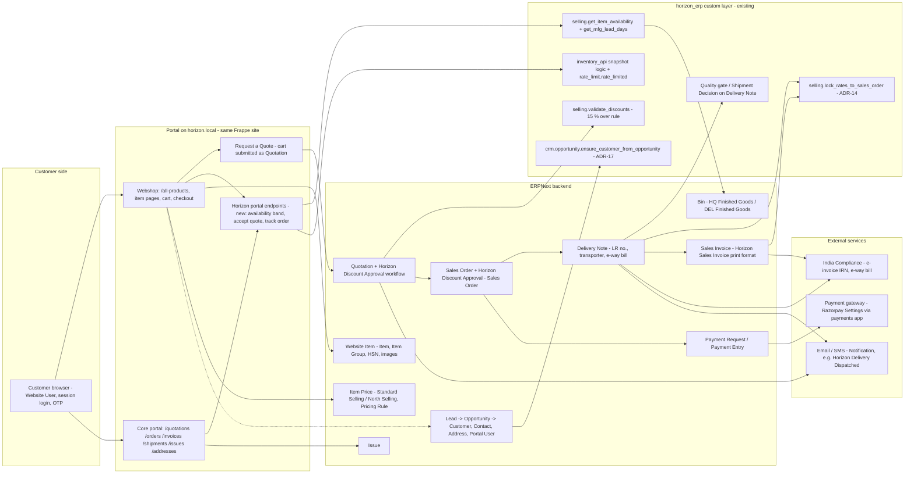
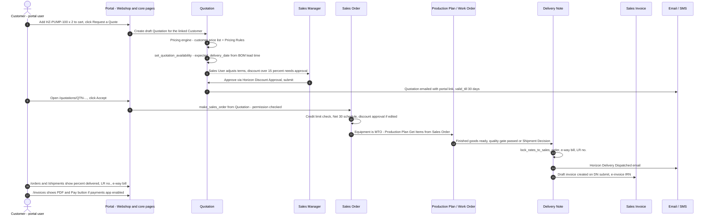

# 09 - E-Commerce Portal Design (bonus, Designed only)

Status: **Designed only** - nothing in this document is installed or configured on `horizon.local`.
It extends requirement BN-1 (`01_configuration_design.md`, section 5) and the short sketch in
`README.md` *Bonus designs*. Every doctype, route and hook named below exists in Frappe 15.96 /
ERPNext 15.94 / India Compliance 15 / `payments` on this bench, or in the `horizon_erp` app, unless
marked **(new)**. Effort figures are estimates, marked *est.*

## 1. Summary and recommendation

Horizon is B2B: a small number of known industrial buyers, credit terms (Net 30), customer-group and
territory pricing, GST on every line and make-to-order equipment with a 21-28 day lead time. The
recommendation is to **install the Frappe Webshop app (`frappe/webshop`, v15 branch) on the same
site and combine it with ERPNext's standard customer portal**, B2B-first:

- **Spares (SP-IMPELLER, SP-SEAL-SET, SP-BELT-KIT, make-to-stock)** - direct order: catalog -> cart
  -> checkout -> Sales Order on the customer's Net 30 terms (prepaid via Payment Request for new or
  over-limit customers).
- **Equipment (HZ-PUMP-100 at INR 1,85,000, HZ-CONV-200 at INR 2,40,000, make-to-order)** - *Request a
  Quote*: cart -> Quotation -> the existing *Horizon Discount Approval* workflow -> customer accepts
  online -> Sales Order -> Production Plan.
- **All customers** - the standard portal pages `/quotations`, `/orders`, `/invoices`, `/shipments`,
  `/issues`, `/addresses` for self-service tracking.

ERPNext v15 removed the e-commerce doctypes from core (`erpnext/patches/v15_0/delete_ecommerce_doctypes.py`);
`Website Item`, `Webshop Settings` and the cart now live in Webshop, which is **not installed** on this
bench (`ls apps/` has no `webshop`). The portal pages, `Portal Settings`, `Portal User` and
`has_website_permission` hooks are still in core and already active.

### Options compared

| Criterion | **A. Webshop + core portal (recommended)** | B. Custom Frappe portal pages only | C. Headless / Shopify + connector |
| --- | --- | --- | --- |
| Licence / run cost | Free (MIT), same server | Free, same server | Shopify plan + connector + sync middleware |
| Real-time stock and price | Direct reads of `Bin`, `Item Price`, `Pricing Rule` | Direct | Batch sync (minutes to hours); stock oversell risk on MTO/MTS mix |
| Pricing-rule reuse (Premium 5 %, volume 8 %, Q4 spares 10 %, North +3 %) | Automatic - cart is a Quotation priced by the ERPNext engine | Automatic if pages call the engine | Must be re-modelled in Shopify (B2B price lists, discount scripts); two sources of truth |
| GST (CGST+SGST vs IGST, two GSTINs, HSN, e-invoice / e-way bill) | India Compliance on the Quotation / SO / SI as today | Same | Shopify computes indicative tax only; ERP must recompute; mismatches |
| Credit limit, Net 30, discount approval, SO rate lock (ADR-14) | All existing hooks run unchanged | Same | Re-implemented or bypassed |
| Build effort | Low-medium (configuration + ~4 small portal endpoints) | High (catalog, cart, checkout from scratch) | Medium-high (connector, mapping, reconciliation) |
| Upgrade risk | Webshop follows Frappe major versions; low customisation surface | Owned code, all on Horizon | Two vendors, API version drift |
| Consumer-grade UX / SEO | Adequate for B2B | Whatever is built | Best |

Option C only pays off for a high-volume B2C catalogue, which Horizon does not have (open question Q1).
Option B is the fallback if Webshop cannot be installed (e.g. a hosting restriction).

## 2. Architecture

Key choices:

| Decision | Rationale |
| --- | --- |
| Same site, no separate storefront DB | One source of truth; portal reads the same `Bin`, `Item Price`, `Pricing Rule` as desk users |
| Customers are **Website Users** with role *Customer*, linked through `Customer.portal_users` (child doctype `Portal User`) | This is the link ERPNext's `website_list_for_contact.get_parents_for_user` uses to scope every portal list |
| Cart = draft Quotation | Webshop's cart is a Quotation, so `Quotation.before_validate` / `validate` hooks in `hooks.py` (`switch_quotation_to_customer`, `validate_discounts`, `set_quotation_availability`) run on portal quotes too |
| Thin Horizon portal endpoints **(new)** wrap existing functions | `get_item_availability` checks `Item` read permission and returns exact free qty per warehouse; `get_inventory_snapshot` returns `stock_value` and `max_valuation_rate`. Neither may be exposed raw to a Website User |
| Desk stays internal | Website Users never get desk access (`/app` redirects them to the portal) |

### Request a Quote -> order -> delivery -> invoice -> tracking

## 3. Data flows

### Backend -> portal

| Data | Source doctype / method | Refresh | Shown to | Notes |
| --- | --- | --- | --- | --- |
| Catalog: name, description, specs, images, item group, HSN | `Website Item` (Webshop) published from `Item`; `Item Group`; `gst_hsn_code` on Item | On publish (cached page) | Everyone | Only items with a `Website Item`; raw materials and sub-assemblies never published |
| Price per logged-in customer | `Item Price` of the customer's price list (`Customer.default_price_list`, e.g. North Selling for North territory, else Webshop default Standard Selling) + `Pricing Rule` | Real-time on cart update | Logged-in customers | Premium 5 %, volume 8 % (qty >= 51), Q4 spares 10 % apply automatically and add up (ADR-14 / PR-4) |
| Price for guests | Standard Selling list price, or "Login for price" | Cached | Guests | Open question Q2; Webshop setting to hide price for guests |
| Stock status | `Bin` (`actual_qty - reserved_qty`) over HQ Finished Goods - HML and DEL Finished Goods - HML, same query shape as `inventory_api.fetch_snapshot_rows` | Cached 5 min per item *est.*; invalidated on Stock Ledger Entry for published items | Everyone (banded) | Bands only: *In stock*, *Limited stock*, *Made to order - ships in N days*. No exact qty for guests; exact qty for logged-in customers only if Q5 says so |
| Fulfilling location | Customer billing / shipping state -> Delhi DC for North, Mumbai HQ otherwise | Per checkout | Customer | Rule to confirm (Q4); drives the SO `set_warehouse` and the company GSTIN on the document |
| Delivery estimate | `selling.get_item_availability` + `get_mfg_lead_days` (multi-level BOM operations + longest component lead time); `STOCK_AVAILABLE_LEAD_DAYS = 2` ex-stock | Real-time on cart line | Customer | Shown as a date range; Quotation row keeps `expected_delivery_date` |
| Tax | India Compliance: place of supply from the customer address; CGST + SGST same state as fulfilling GSTIN (27 Mumbai / 07 Delhi), IGST otherwise; Item Tax Templates by Item Group | Real-time in cart | Customer | Cart total is tax-inclusive preview; the Sales Order is authoritative |
| Quotations | `Quotation` via `/quotations` (`has_website_permission`) | Real-time | Owning customer | Draft / pending-approval quotes show "Under review", not internal discount fields |
| Orders | `Sales Order` via `/orders`: status, `per_delivered`, `per_billed`, `delivery_date` | Real-time | Owning customer | |
| Shipments / tracking | `Delivery Note` via `/shipments`: `transporter`, `lr_no`, `lr_date`, India Compliance `ewaybill` | On DN submit | Owning customer | Plus *Horizon Delivery Dispatched* notification |
| Invoices | `Sales Invoice` via `/invoices`, PDF in *Horizon Sales Invoice* print format, IRN / QR | On submit | Owning customer | Only submitted invoices; drafts auto-created on DN submit are hidden |
| Payments, outstanding | `Payment Request`, `Payment Entry`, `Sales Invoice.outstanding_amount` | Real-time | Owning customer | Pay button on order / invoice page when `payments` app is installed (`templates/pages/order.py`) |
| Credit position | `Customer Credit Limit` vs outstanding (`get_customer_outstanding`) | On page load | Owning customer | Show "available credit" only, not the internal limit history (Q6) |
| Support | `Issue` via `/issues` | Real-time | Owning customer | Linked to Sales Order / serial no. for warranty |

### Portal -> backend

| Event | Target doctype / method | Control |
| --- | --- | --- |
| B2B sign-up | `Lead` (source *Website*), no Customer yet | Sales qualifies into `Opportunity`, fills GSTIN / credit / Net 30, then `ensure_customer_from_opportunity` creates the Customer and the user is added to `portal_users` (ADR-17). No self-created Customers |
| Request a Quote | Draft `Quotation` (cart) | Existing discount approval; `valid_till` 30 days (`set_quotation_valid_till`) |
| Accept quote | `Sales Order` from Quotation **(new endpoint)** | `has_website_permission` on the Quotation, quote not expired, submitted state |
| Direct order (spares) | `Sales Order` from cart checkout | Credit limit check; above a portal order cap *est.* INR 5 L -> draft for Sales review |
| Payment | `Payment Request` -> gateway -> `Payment Entry` | Gateway callback signature verified by `payments` app |
| Address change | `Address` via `/addresses` | GSTIN or state change -> held for verification (see 4) |
| Issue / complaint | `Issue` | Rate limited; attachments private |

## 4. Security

| Risk | Control | ERPNext / Horizon mechanism |
| --- | --- | --- |
| Customer sees another customer's documents | All portal lists and pages filter by the customers linked to the session user | `has_website_permission` (Sales Order, Quotation, Sales Invoice, Delivery Note, Issue, Project in `erpnext/hooks.py`), `website_list_for_contact.get_list_context` / `get_customers_suppliers` via `Portal User`; new Horizon endpoints call the same check |
| Horizon Delivery Note permission query hides portal shipments or leaks them | Regression test: Website User sees own DNs only | `horizon_stock.permissions.delivery_note_query` must return the customer filter for role *Customer* |
| Price list leakage (Premium / North rates seen by others) | Prices computed server-side per session; no public price JSON; guests see list price or none | Pricing engine on the cart Quotation; Webshop hide-price-for-guest |
| Exposure of cost, valuation, exact stock | Portal endpoints return bands and dates only; never `stock_value`, `valuation_rate`, `rule_rate`, `discount_over_rule_pct` | New wrapper around `inventory_api` logic; portal Quotation template excludes Horizon internal fields |
| Fraudulent GSTIN / address change redirects goods or tax credit | GSTIN or state change on a portal Address creates a review task; new GSTIN validated | India Compliance GSTIN checksum + GSTIN status check; Sales Manager approval before use on an order |
| Large or abnormal orders | Credit limit, order cap, discount approval | `Customer Credit Limit` (Selling), *Horizon Discount Approval - Sales Order* workflow, blacklist / Shipment Decision checks unchanged |
| Scraping, bots, quote spam | Per-user and per-IP limits on catalog-stock, quote and issue endpoints; CAPTCHA on sign-up | Reuse `rate_limit.rate_limited` (Redis fixed window, ADR-7/8) with a portal limit *est.* 300 / h per user; `frappe.rate_limiter.rate_limit` for guest routes; Website Settings `disable_signup` if B2B-only by invitation |
| Session hijack / CSRF | Session cookies only, HTTPS, CSRF token on POST; API keys never issued to Website Users | Frappe CSRF and session handling; nginx TLS |
| Weak passwords / account takeover | OTP on login for Website Users | System Settings `enable_two_factor_auth` (OTP by email / SMS / authenticator), password policy |
| Personal data (DPDP Act 2023, India) | Purpose-limited collection (B2B contact data), consent text at sign-up, data access / erasure requests, breach process | Frappe `Personal Data Download Request`, `Personal Data Deletion Request`; privacy policy page |
| Card data / PCI DSS | Card entry happens on the gateway's hosted checkout; Horizon stores only the payment reference | `payments` app Razorpay Settings; Payment Request status callback |
| Attachments (drawings, invoices) readable by URL | Private files only; access through the parent document permission | Frappe private files (`/private/files`) |
| Repudiation ("I never ordered that") | Every portal document has `owner` = portal user, version history, IP in Access Log; order confirmation email | Frappe Version / Activity Log, Access Log |
| Privilege confusion | Website User vs System User; portal roles (*Customer*) have no desk perms; `Portal Settings.default_role` = Customer | Frappe user types; Role Permission Manager review in UAT |
| Admin surface | `/app` and `/api` keys restricted to staff; admin by VPN / IP allow-list | nginx rules; `User.restrict_ip` on staff users |

## 5. Implementation approach

### Phased plan

| Phase | Scope | Effort *est.* (person-days) | Dependencies |
| --- | --- | --- | --- |
| **1 - MVP (spares + self-service)** | Install Webshop v15; Webshop Settings (default price list Standard Selling, show stock, checkout on); publish `Website Item` for the three spares; customer price list + pricing rules verified in cart; checkout -> Sales Order on Net 30 for existing customers; portal users for pilot customers; core portal pages `/orders`, `/invoices`, `/shipments`; stock band endpoint with cache + rate limit; UAT with one Premium-West and one Standard-North customer | 12-15 | Webshop app approval; customer contact e-mails; Q2, Q4, Q5 answered |
| **2 - Quotes and payments** | Equipment items published as *Request a Quote* (no checkout); cart -> Quotation -> existing approval; *Accept quote* endpoint -> Sales Order; Payment Request + Razorpay for new / prepaid / over-limit customers; Lead capture from sign-up with ADR-17 flow; notification templates (quote ready, order confirmed) | 10-12 | Gateway merchant account; Q3 answered |
| **3 - Tracking, service, analytics** | Order tracking page (SO -> Work Order progress for MTO, DN LR / e-way bill); `/issues` linked to Sales Order and serial no., routed to Quality (Quality Action); reorder from past order; portal KPIs in a *Horizon Selling* workspace number card | 8-10 | Phase 1 live for 1 month |

### What changes in the current Horizon design

| Area | Change |
| --- | --- |
| Masters | `Website Item` per sellable item (spares, equipment); item images, specs, HSN shown; equipment flagged "quote only" **(new Custom Field on Website Item)** |
| Customers | `Portal User` rows on each Customer; *Customer* role; Contact e-mail verified |
| Code (`horizon_selling`) | New `portal.py` **(new)**: `get_stock_band(item_code)`, `get_delivery_estimate(item_code, qty)`, `accept_quotation(name)`, each permission-checked, rate limited and cached; reuses `get_item_availability` without its desk `Item` read check |
| Hooks | `Quotation` hooks already apply; confirm `validate_price_list_rates_untouched` treats portal users as non-managers (it does by role) |
| Permissions | `delivery_note_query` extended for role *Customer*; Role Permission review for Website Users |
| Notifications | Add *Horizon Quote Ready*, *Horizon Order Confirmed* **(new)**; reuse *Horizon Delivery Dispatched*, *Horizon Quotation Expiring* |
| Tests | Add to `05_test_plan_and_evidence.md`: cross-customer access denied, Premium price only for Premium, guest sees no qty, rate limit 429, accept expired quote refused |

### Risks and mitigations

| Risk | Mitigation |
| --- | --- |
| Webshop app lags a Frappe minor release | Pin the Webshop tag tested with 15.96; upgrade in staging first |
| Portal order bypasses capacity planning for equipment | Equipment is quote-only; SO from accepted quote feeds Production Plan as today (ADR-4) |
| Customers expect exact stock and get "Limited" | Clear band thresholds; exact qty for logged-in users if Q5 allows |
| Low adoption by long-standing customers | Pilot with 3 customers; sales team places orders "on behalf" through the same flow |
| GST mismatch between cart preview and invoice | Invoice is mapped from the SO with locked rates (ADR-14); preview labelled indicative |

### Success KPIs

| KPI | Baseline | Target *est.* (6 months) |
| --- | --- | --- |
| Share of spares orders placed on the portal | 0 % | 40 % |
| Quote turnaround (request -> submitted Quotation) | To be measured | < 24 h |
| Quote-to-order conversion on portal quotes | To be measured | +10 pts vs offline |
| DSO for portal customers | Current DSO | -5 days (online payment, invoice self-service) |
| "Where is my order" support tickets | To be measured | -50 % |

### Open questions for the client

| # | Question | Why it matters |
| --- | --- | --- |
| Q1 | B2B only, or B2C spares sales too? | B2C changes sign-up, payment (prepaid), GST (unregistered), and could favour option C |
| Q2 | Should guests see prices? | Price list confidentiality vs lead generation |
| Q3 | Net 30 for portal orders, or prepaid for new customers? | Gateway scope and credit control |
| Q4 | Delhi DC fulfilment rule - by customer state, by stock, or split shipments? | Warehouse on the SO, which GSTIN invoices, inter-branch transfers (ADR-10) |
| Q5 | Show exact stock quantity to logged-in customers? | Competitive sensitivity |
| Q6 | Show available credit on the portal? | Commercial sensitivity |
| Q7 | Who approves a portal sign-up - Sales, or Finance for credit terms? | ADR-17 Opportunity owner |

## 6. Assumptions

1. Webshop v15 is installable on this bench and its cart remains a Quotation with `order_type` *Shopping Cart*.
2. All portal customers are registered businesses with a GSTIN; unregistered buyers are out of scope unless Q1 says otherwise.
3. One company (HML) and the two GSTINs stay as designed (ADR-1); no separate e-commerce company.
4. Pricing stays in `Item Price` + `Pricing Rule`; no portal-only price lists or coupon codes in Phase 1.
5. Razorpay is the gateway (supported by the installed `payments` app); any other gateway in that app works the same way.
6. Stock bands are computed from the two Finished Goods warehouses only; QC Hold, Rejected and Transit stock is never shown as available.
7. Effort, cache duration, rate limits, order cap and KPI targets are planning estimates, to be confirmed in a discovery workshop.
8. Hosting provides HTTPS, nginx and Redis as for the existing site; no CDN is assumed in Phase 1.
